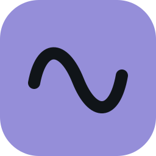

<p align="center">
  
</p>

# YokoWave · 波枢

[](https://github.com/ajtn123/YokoWave/actions/workflows/build.yml)
[](https://github.com/ajtn123/YokoWave/actions/workflows/release.yml)
[](https://github.com/ajtn123/YokoWave/releases/latest)
[](global.json)
[](src/YokoWave.App/YokoWave.App.csproj)

基于 .NET 与 Avalonia 的跨平台设备控制应用，支持 YOKONEX 和 DG-LAB 设备。用节点图组合波形、触控、音频、传感器与设备输出；同一模板可创建多个实例，分别控制不同设备。

- **设备管理**：扫描、连接、自动重连、硬件设置及按型号提供的协议操作。
- **节点玩法**：波形、滑动、声控、禁锢、运动、睡眠剥夺、泵和原生程序模板；支持自定义图与子图模板。
- **波形管理**：66 条内置波形（YOKONEX 22 条、郊狼 24 条、负鼠 20 条）、自定义播放列表、采样编辑和统一格式导入导出。
- **远程设备**：WebSocket GATT 透传、高层控制与 [DG-LAB V4](docs/dglab-v4.md) App 配对；支持被控节点及内置 V4 中继，可与本地设备同时使用。
- **远程事件**：[WebSocket 事件](docs/websocket-events.md)客户端声明并发送触发／数值事件，节点图选择事件后连接波形、数值处理和设备输出。
- **浏览器模块**：[恐龙游戏](docs/dinosaur.md)，碰撞时通过现有 WebSocket 服务端输出短脉冲。
- **界面**：English / 简体中文，跟随系统字体、明暗主题及可用的强调色。

## 当前支持

| 平台 | 本地模拟 / WebSocket | 原生蓝牙 | 音频 |
| --- | --- | --- | --- |
| Windows 10 2004+ | 支持 | 支持 | 媒体文件、麦克风、系统播放声音 |
| macOS / Linux | 支持 | 尚未实现 | 媒体文件、麦克风后端已实现，待平台实测 |
| Android / iOS | 尚未提供入口 | — | — |

已接入 YOKONEX 电击器 V1/V2、震动器、灌肠机，郊狼 V2/V3、负鼠、爪印 V1.1 和灵猫。协议替身测试覆盖全部已接入驱动；实机验证范围与能力限制见[蓝牙实现](docs/bluetooth.md)。跨设备使用同一波形不表示物理输出等价。

## 下载与使用

从 [GitHub Releases](https://github.com/ajtn123/YokoWave/releases/latest) 下载对应系统和处理器的便携包。v1.0.0 提供以下版本，均自带 .NET 与 ASP.NET Core 运行时，无需安装 SDK：

Apple 芯片 Mac 使用 ARM64，Intel Mac 使用 x64。完整解压并保留所有文件：Windows 运行 `YokoWave.exe`，macOS 打开 `YokoWave.app`，Linux 运行 `./YokoWave`。发行包没有开发者证书签名，macOS 使用临时签名且未公证，首次打开可能需要在系统安全设置中允许。Linux 仍需系统的图形、字体和音频依赖，见 [Avalonia Linux 运行要求](https://docs.avaloniaui.net/docs/platform-specific-guides/linux)。

1. 首次启动使用本地模拟。使用实机时，在「偏好设置 → 设备来源」选择蓝牙并保存。
2. 在「设备工作台」发现并连接设备。
3. 在「节点玩法」选择模板、添加玩法，将设备加入分组，检查输出节点的设备和通道绑定。
4. 调整数值输入及各输出节点上限后点击开始。零强度也可开始；「全部停止」或 `Esc` 停止所有玩法。

完整操作、快捷键、远程连接与排查方法位于应用内「帮助」。保存的玩法不会自动运行；重新连接从关闭输出开始。

[恐龙游戏静态包](https://github.com/ajtn123/YokoWave/releases/download/v1.0.0/YokoWave-v1.0.0-dinosaur.zip) 包含 HTML、JS、CSS 和中英文词典，解压后用 Python 内置 HTTP 服务运行，步骤见[模块说明](docs/dinosaur.md)。

## 从源码运行

安装 **.NET 10 SDK** 后执行：

```sh
git clone https://github.com/ajtn123/YokoWave.git
cd YokoWave
dotnet restore YokoWave.slnx
dotnet run --project src/YokoWave.Desktop
```

## 文档入口

| 读者 / 用途 | 入口 |
| --- | --- |
| 使用应用 | 应用内「帮助」用户手册 |
| 开发、验证与交付 | [CONTRIBUTING.md](CONTRIBUTING.md) |
| 模块、源码位置与实现细节 | [docs 索引](docs/README.md) |
| 自动化代理 | [AGENTS.md](AGENTS.md) |

用户数据路径可在设置页查看；存储和损坏保护规则见[本地存储](docs/storage.md)。

第三方波形数据的来源与许可见[第三方数据声明](THIRD-PARTY-NOTICES.md)。
