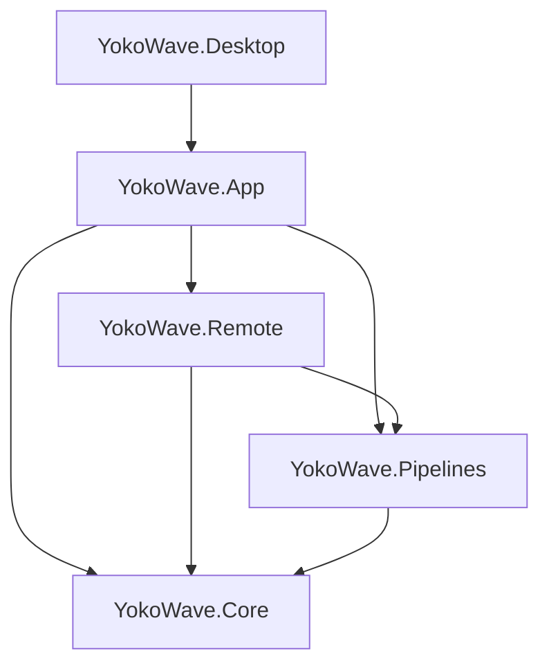

# 架构

## 项目边界

| 模块 | 拥有的职责 | 边界 |
| --- | --- | --- |
| Core | 设备模型、能力、操作锁、协议驱动、统一波形、输入契约与工作区存储 | 不引用 Windows SDK、UI 或节点控件 |
| Pipelines | 图、注册表、编译、同步处理器、资源参与者、后台会话 | 纯 .NET，不保存 UI 模型；处理器不做 I/O |
| Remote | RPC、租约、GATT／control 客户端、服务端及网络节点 | 远程播放仍编译为图，复用控制器和会话 |
| App | Avalonia 页面、编辑器、绑定、交互及显示 | Nodify 只存在于此；不承担协议编码 |
| Desktop | 入口、原生蓝牙、音频及诊断 | 通过 Core 输入／传输契约注入平台能力 |

具体文件见[源码地图](source-map.md)。配置使用记录和值快照，运行对象拥有状态和资源；共享行为通过组合复用，只有多种实现的真实边界才提取接口。

## 三种所有权

**图实例**拥有节点、连线、布局、播放列表、定时、设备分组和引用，以及每个输出节点的上限。模板只创建普通图；同一模板的实例不共享处理器状态。设备分组用于归属，节点引用决定实际运行资源，两者不互相替代。

**设备连接**拥有实时读数、协议状态和 GATT 生命周期。硬件选项按设备标识保存，与图参数分开。`DeviceController` 按设备 ID 串行化输出、通知和关闭，批量占用按固定顺序取得目标门再验证，避免反向申请死锁。每台设备只归一个会话；暂停仍保留占用。

**运行会话**拥有单调时钟、编译快照、独立处理器、输入／网络参与者和输出派发器。开始只原子申请节点实际引用的设备，未引用的分组成员不参与 I/O。连接与重新连接都不恢复运行会话。

## 执行与清理

`PipelineCompiler` 反序列化并验证注册配置，展开子图，校验端口、范围、循环、资源冲突和目标能力，生成独立的配置／波形快照。`PipelineRuntime` 每帧按拓扑同步求值；有效期和模拟来源沿数值传播。

`PipelineSession` 在后台约每 100 ms 捕获输入、求值并提交。`DeviceOutputCoordinator` 先应用各通道的节点上限，再合并成设备帧；`PipelineOutputDispatcher` 先发命令，再并行派发独立设备，等待每台设备在途写入，仅记录成功发送的输出峰值。同设备操作继续受控制器门保护。

停止先阻断后续输出、撤销网络控制，再尝试归零、关闭流、释放输入和设备占用。停止可以取消尚未完成的输入启动。原始错误与清理错误同时保留；停止未确认的设备保持占用，可重试停止。断连或输出错误只停止所属会话；全部停止、Esc、切换本地来源及应用关闭使用统一协调流程。详见[管线生命周期](pipelines.md#会话生命周期)。

## 平台与网络

`BluetoothDeviceTransport` 管发现和路由，每条连接由 `BluetoothDeviceSession` 拥有链路、驱动、初始化门和 GATT 租约切换。能力及驱动工厂是协议选择入口，UI 和命令检查共用这些定义。统一波形只在发送时按设备编码，资产不保存协议包。

GATT 客户端将远程链路交给同一协议驱动工厂；control 客户端发送统一帧和类型化命令。GATT 服务端把链路交给远端驱动，control 服务端将请求缓冲为本地节点输入，继续经过本地图的处理、限幅及输出路由。认证、时钟、顺序号和续期由共享客户端连接维护，见 [WebSocket](websocket.md)。

[DG-LAB V4](dglab-v4.md) 的设备来源、中继和被控端使用独立协议。连接池只管理运行期连接引用，App 路由拥有请求与插槽的同步边界，插槽拥有输入信箱及增量状态；纯调度器组合不同任务对象。网络请求不直接驱动硬件，仍将数值输入交给同一管线和输出路由。

平台音频输出有时间戳的特征，传感器参与者消费控制器已校验的快照。缺失／过期输入归零等待，真实错误停止图；模拟来源不能跨入真实输出。见[输入](inputs.md)。

## 界面与数据

`MainViewModel` 组合设备、设置、波形、历史和管线工作区，协调导航、保存与关闭。页面直接绑定所属 VM。`PipelineEditorViewModel` 管草稿和会话，`PipelineEditHistory` 管有界快照，`PipelineGraphClipboard` 管图片段复制和 ID 重映射；分组投影保持现有卡片实例。参数编辑不重建节点或字段对象。

`WorkspaceStore`、`PipelineStore` 和 `SessionJournal` 分别管理工作区文件、图文件和滚动日志，不把保存流程混入协议或同步求值。文件契约及重置边界见[存储](storage.md)。颜色、尺寸、字体、本地化和用户帮助的实现见[界面与本地化](localization.md)。
